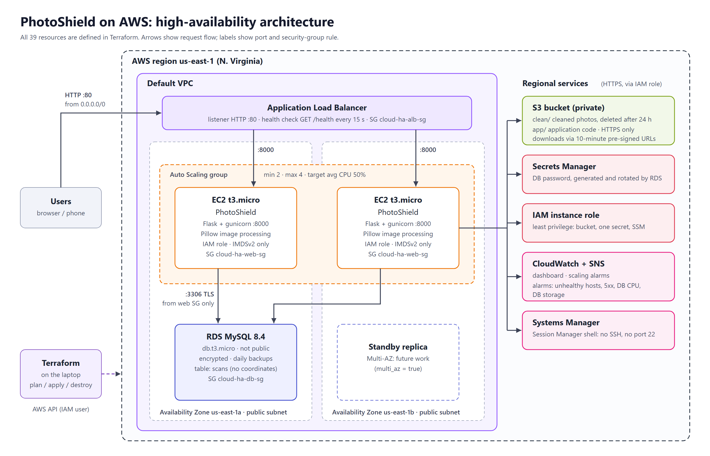
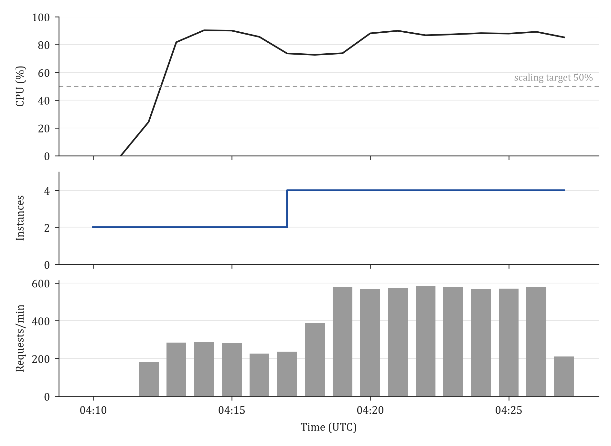

# PhotoShield: a high-availability photo-privacy service on AWS

Phone and camera photos carry hidden EXIF/XMP metadata: the exact GPS location, the device and its serial
number, and the time the photo was taken. **PhotoShield** shows what a photo gives away and returns a clean
copy containing only the pixels.

The application runs on a highly available, auto-scaling AWS architecture defined entirely in Terraform.
It was built for the UCS531 Cloud Computing course at Thapar Institute of Engineering & Technology.



## Features

- Detects GPS coordinates (EXIF and XMP), altitude, device, lens, serial number, timestamp, software,
  embedded comments and text fields, and rates the privacy risk as high, medium or low.
- Produces a clean JPEG rebuilt from raw pixel data, so no metadata can be carried over.
- Stores cleaned photos in a private S3 bucket (downloads via 10-minute pre-signed URLs, auto-deleted after 24 hours).
- Records each scan in RDS MySQL: only counts and yes/no flags, **never the coordinates**.
- Shows which server and Availability Zone handled each request, so load balancing is visible.

## Architecture

| Layer | Service | Configuration |
|---|---|---|
| Load balancing | Application Load Balancer | HTTP :80, health check `GET /health` every 15 s |
| Compute | EC2 Auto Scaling group | t3.micro, Amazon Linux 2023, 2 to 4 instances across us-east-1a and us-east-1b, target tracking at 50% CPU, ELB health checks, rolling instance refresh |
| Database | RDS MySQL 8.4 | db.t3.micro, private, encrypted, daily backups, password managed in Secrets Manager |
| Storage | S3 | private, SSE, TLS-only bucket policy, 24-hour lifecycle on `clean/` |
| Security | IAM, security groups, SSM | least-privilege instance role, IMDSv2 only, SG chain ALB → web → DB, Session Manager instead of SSH |
| Monitoring | CloudWatch, SNS | dashboard, alarms for unhealthy hosts, 5xx errors, DB CPU and storage |

Security groups allow only: internet → ALB on 80, ALB → instances on 8000, instances → RDS on 3306.
Instances download the application from S3 at boot and run it as an unprivileged user under systemd.

## Measured results

| Test | Result |
|---|---|
| Fresh deployment to all targets healthy | 13.4 min |
| Rolling update replacing both instances | 14.5 min, 79/79 requests OK, **0 failed** |
| Processing time on t3.micro | ~465 ms for a 6 MP photo, 45-90 ms for 1-1.6 MP |
| Load test (24 concurrent users, 15 min) | 6,676 requests, 0 failed; scaled 2 → 4 instances; throughput 4.7 → 9.6 req/s |
| Failover (terminate 1 of 2 instances) | replacement healthy after 3.1 min; 5 of 177 requests failed in the first 21 s |



See the [project report](docs/report/PhotoShield_Report.pdf) for the full analysis.

## Repository layout

```
app/                Flask application (deployed to S3, downloaded by each instance)
  app.py            routes, S3 and RDS access, Secrets Manager credentials
  photoshield.py    metadata analysis and removal (no AWS dependencies)
  templates/        HTML pages
terraform/          all infrastructure (39 resources)
scripts/            up.ps1 / down.ps1, load and failover tests
tests/              unit and route tests (S3 and MySQL faked)
docs/               architecture diagram, demo guide, code walkthrough
```

## Running it

Requirements: an AWS account, the AWS CLI configured with an IAM user's keys (`aws configure`, not the
root account), and Terraform 1.9+, both on PATH. Everything is created in your own account and billed to it.

On Windows:

```powershell
powershell -ExecutionPolicy Bypass -File scripts\up.ps1     # build everything (~15 min), opens the site
powershell -ExecutionPolicy Bypass -File scripts\down.ps1   # delete everything (asks for confirmation)
```

On any OS:

```bash
cd terraform
terraform init
terraform apply      # prints app_url; the site is ready a few minutes after apply finishes
terraform destroy    # delete everything when done
```

Running the stack costs about $2 per day; destroy it when not in use.
Optional settings go in a git-ignored `terraform/terraform.tfvars` (see `terraform.tfvars.example`).

Local tests:

```powershell
python -m venv .venv
.venv\Scripts\pip install flask pymysql boto3 pillow pytest
.venv\Scripts\python -m pytest tests
```

## Known limitations

- RDS is single-AZ to stay within free-tier limits; `multi_az = true` adds a standby with automatic failover.
- The site is HTTP only; HTTPS needs a domain with an ACM certificate or CloudFront.
- Instances use the default VPC's public subnets (protected by security groups) to avoid NAT gateway cost.
